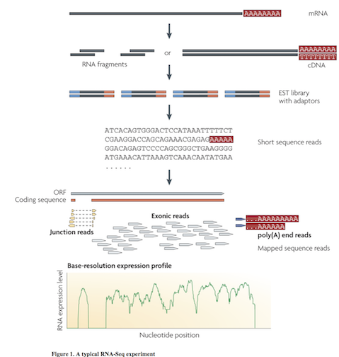
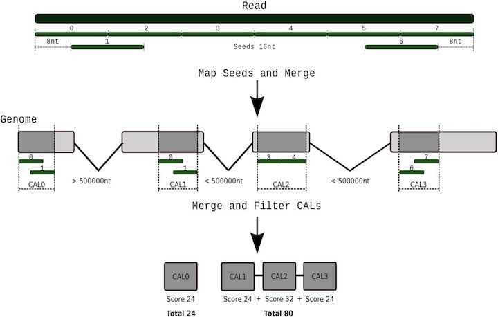
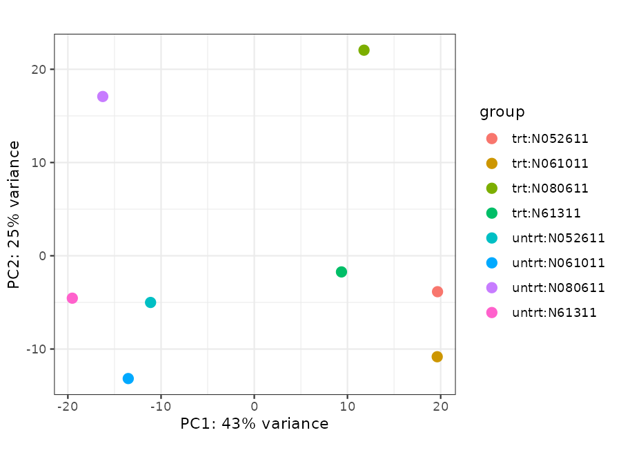

# RNA-Seq

RNA-Seq sequences the transcripts (mRNA) of a cell, tissue or organism.
The number of reads from a gene is a measure of its expression.
The most common question is: which genes change expression between conditions? This is called differential expression (DE).

This lecture covers bulk RNA-Seq. For single cells, see the [single-cell RNA-Seq lecture](scRNASeq).

## Learning goals

After this lecture you can:

1. Plan an RNA-Seq experiment with enough biological replicates and no confounding.
2. Run read QC, quantification (salmon or kallisto) and genome alignment (HISAT2 + featureCounts) on the cluster.
3. Find the strandedness of a library.
4. Run a DE analysis with DESeq2 and read its output.
5. Make and interpret the standard plots: PCA, sample distances, p-value histogram, MA, volcano, heatmap.
6. Explain why TPM/FPKM are not used for DE tests.



Wang et al. 2009. Nat Rev Genet. doi:[10.1038/nrg2484](https://doi.org/10.1038/nrg2484)

# Design comes first

No analysis can fix a bad design. Decide these points before you sequence.

* **Biological replicates**: independent samples (different cultures, animals, donors). They measure biological variation. **Technical replicates** (the same library sequenced twice, or one sample on several lanes) do not. Add technical replicates together; do not count them as replicates.
* **How many?** Three per condition is the minimum. Schurch et al. 2016 recommend at least 6 per condition, and at least 12 to find most DE genes, including those with small fold changes.
* **Confounding**: if all controls are processed on one day, one machine or one kit, and all treated samples on another, you cannot separate the treatment from the batch. Spread conditions over batches. Record the batch in the sample sheet.
* **Library type**:
  * poly-A selection: mature mRNA only. Most common for eukaryotes.
  * rRNA depletion: also non-polyadenylated and pre-mRNA. Needed for bacteria and degraded RNA.
  * stranded or unstranded: stranded libraries tell you which DNA strand the RNA came from. Most current kits are stranded.
* **Read layout and depth**: for gene-level DE, 10-30 million single-end or paired-end reads per sample is common for a mammal. Small genomes such as yeast need fewer. For isoforms or new transcripts, use paired-end reads and more depth.

## A real example of confounding

The example data for this class comes from a yeast study of the antifungal Amphotericin B (AmB). NCBI BioProject [PRJNA318684](https://www.ebi.ac.uk/ena/browser/view/PRJNA318684).
In earlier years we used this sample sheet:

| Run | Label | Instrument | Layout | ENA sample title |
|---|---|---|---|---|
| SRR3396418, 17, 16 | Control | NextSeq 500 | single | Matched control for **LF only** rep 3 |
| SRR3396381, 82, 84 | AmpB | HiSeq 2000 | paired | AMB only rep 1-3 |

This design has two problems:

1. Condition is confounded with instrument and read layout. A difference can come from the drug or from the machine.
2. The three "controls" are all "rep 3" of a different experiment. They are not three biological replicates.

The study has the correct controls: "Matched control for AMB only rep 1-3". These are paired-end HiSeq runs, like the AmB samples. **Lesson: always read the sample metadata (ENA or SRA) before you download.**

The corrected sample sheet `samples.tsv` (tab separated: run, condition, replicate):

```text
SRR3396385	Control	Rep1
SRR3396386	Control	Rep2
SRR3396387	Control	Rep3
SRR3396381	AmpB	Rep1
SRR3396382	AmpB	Rep2
SRR3396384	AmpB	Rep3
```

# Two ways to quantify expression

1. **Align to the genome, then count reads per gene.** Use a splice-aware aligner, because reads from mRNA cross exon-exon junctions. Use this route when you need a BAM file: for a genome browser, new genes or transcripts, splicing or variants.
2. **Quantify against the transcript sequences** (pseudo-alignment / selective alignment). Faster, needs less memory, and handles reads that match several isoforms. This is a good default for gene-level DE when you have a good annotation.

If there is no genome, assemble the transcripts *de novo* first (see Trinity below).



Tarraga et al 2017. DNA Research. doi:[10.1093/dnares/dsv039](https://doi.org/10.1093/dnares/dsv039)

Splice-aware aligners:

* [STAR](https://github.com/alexdobin/STAR): fast and accurate, needs about 32 GB of memory for a human index.
* [HISAT2](https://daehwankimlab.github.io/hisat2/): needs less memory.
* [GMAP/GSNAP](http://research-pub.gene.com/gmap/): also handles long reads and polymorphisms.
* TopHat is obsolete. Do not use it.

Transcript quantifiers:

* [salmon](https://combine-lab.github.io/salmon/) (Patro et al. 2017)
* [kallisto](https://pachterlab.github.io/kallisto/) (Bray et al. 2016)

# Worked example: yeast treated with AmB

All scripts are in `/bigdata/gen220/shared/data-examples/rnaseq/scripts/`. Copy them to your own project folder. Run each script from the project folder.

## Step 0. Project layout

```bash
mkdir -p ~/bigdata/RNASeq && cd ~/bigdata/RNASeq
mkdir -p logs genome data results plots scripts
cp /bigdata/gen220/shared/data-examples/rnaseq/scripts/* scripts/
cp /bigdata/gen220/shared/data-examples/rnaseq/kallisto/data/samples_AMB.tsv samples.tsv
G=/bigdata/gen220/shared/data-examples/rnaseq/yeast_genome
ln -sf $G/S_cerevisiae.fasta.gz $G/S_cerevisiae.gff3.gz $G/S_cerevisiae.ORFs.fasta.gz genome/
```

The genome FASTA, the GFF3 annotation and the transcript (ORF) FASTA all come from the same SGD release (R64-2-1). **Always use a genome and an annotation from the same release.** Different releases can have different chromosome names and gene coordinates.

## Step 1. Get the reads

The FASTQ files are already in `/bigdata/gen220/shared/data-examples/rnaseq/kallisto/data/`. Link them:

```bash
bash scripts/00_link_reads.sh
```

To download your own runs from SRA, use `prefetch` + `parallel-fastq-dump`, and check the read counts against ENA. See `download_runs.sh` in the same folder:

```bash
sbatch download_runs.sh samples.tsv
```

## Step 2. Read quality control

```bash
#!/bin/bash -l
#SBATCH -p short -N 1 -n 1 -c 12 --mem 16G --time 2:00:00
#SBATCH -J qc
#SBATCH -o logs/%x.%j.log
set -euo pipefail
module load fastqc/0.12.1
module load multiqc/1.30
CPU=${SLURM_CPUS_PER_TASK:-1}
mkdir -p results/fastqc
fastqc -t $CPU -o results/fastqc data/*.fastq.gz
multiqc -o results/multiqc results/fastqc
```

Open `results/multiqc/multiqc_report.html` in a web browser. Check:

* per-base quality: the quality drops at the 3' end of reads. Trim if it is very low (`fastp`).
* per-base sequence content: the first 10-12 bases of RNA-Seq reads are often uneven. This comes from random hexamer priming. It is normal; do not trim it.
* duplication: high duplication is normal for RNA-Seq, because highly expressed genes give many identical reads.
* adapter content.

salmon and kallisto work well on untrimmed reads. Trim adapters if you align to the genome and the adapter content is high.

## Step 3a. Quantify with salmon

Build the index once, then run each sample:

```bash
#!/bin/bash -l
#SBATCH -p short -N 1 -n 1 -c 8 --mem 8G --time 2:00:00
#SBATCH -J salmon
#SBATCH -o logs/%x.%j.log
set -euo pipefail
module load salmon/1.7.0
CPU=${SLURM_CPUS_PER_TASK:-1}
mkdir -p index
[[ -d index/Scer_salmon ]] || salmon index -t genome/S_cerevisiae.ORFs.fasta.gz -i index/Scer_salmon -p $CPU
# read from file descriptor 3, so a tool in the loop cannot read samples.tsv by mistake
while read -u 3 ACC COND REP; do
  salmon quant -i index/Scer_salmon -l A \
    -1 data/${ACC}_1.fastq.gz -2 data/${ACC}_2.fastq.gz \
    -p $CPU --validateMappings --gcBias -o results/salmon/${COND}.${REP}
done 3< samples.tsv
```

For each sample, salmon writes:

* `quant.sf`: one row per transcript, with `Length`, `EffectiveLength`, `TPM` and `NumReads` (estimated counts).
* `logs/salmon_quant.log`: the mapping rate.
* `lib_format_counts.json`: the library type that salmon detected.

For a human or mouse study, use the GENCODE transcript FASTA, and add the genome as a "decoy" to the index (see the salmon documentation).

### kallisto does the same job

```bash
module load kallisto/0.48.0
kallisto index -i index/Scer.kidx genome/S_cerevisiae.ORFs.fasta.gz
kallisto quant -t $CPU -i index/Scer.kidx -o results/kallisto/AmpB.Rep1 \
  data/SRR3396381_1.fastq.gz data/SRR3396381_2.fastq.gz
```

With paired-end reads, kallisto measures the fragment length itself. Only for single-end reads must you give `--single -l` (mean fragment length) and `-s` (standard deviation). Get those values from the library preparation (for example a Bioanalyzer trace), not from a guess.

## Strandedness

You must know the strandedness to count reads correctly. A wrong setting can lose half the reads or count antisense reads.
`salmon -l A` reports it in `lib_format_counts.json` and in `logs/salmon_quant.log`:

<!-- TODO YEAST_LIBTYPE_PLACEHOLDER: add yeast results after the run -->

| salmon | Meaning | featureCounts | kallisto | HISAT2 |
|---|---|---|---|---|
| IU | unstranded | `-s 0` | (default) | (default) |
| ISR | read 1 is on the reverse strand (dUTP, Illumina TruSeq Stranded) | `-s 2` | `--rf-stranded` | `--rna-strandness RF` |
| ISF | read 1 is on the forward strand | `-s 1` | `--fr-stranded` | `--rna-strandness FR` |

## Step 3b. The genome route: HISAT2 and featureCounts

```bash
#!/bin/bash -l
#SBATCH -p short -N 1 -n 1 -c 8 --mem 16G --time 2:00:00
#SBATCH -J hisat2
#SBATCH -o logs/%x.%j.log
set -euo pipefail
module load hisat2/2.2.1
module load samtools/1.22.1
module load subread/2.0.6
CPU=${SLURM_CPUS_PER_TASK:-1}
STRAND=${STRAND:-0}     # set from the salmon library type
mkdir -p index results/bam results/featureCounts
if [[ ! -s index/Scer_hisat2.1.ht2 ]]; then
  zcat genome/S_cerevisiae.fasta.gz > index/S_cerevisiae.fasta
  hisat2-build -p $CPU index/S_cerevisiae.fasta index/Scer_hisat2
fi
while read -u 3 ACC COND REP; do
  BAM=results/bam/${COND}.${REP}.bam
  # pipe the SAM output straight into sort: no large SAM file on disk
  hisat2 -p $CPU -x index/Scer_hisat2 -1 data/${ACC}_1.fastq.gz -2 data/${ACC}_2.fastq.gz \
    --summary-file results/bam/${COND}.${REP}.hisat2.txt \
    | samtools sort -@ 4 -o $BAM -
  samtools index $BAM
done 3< samples.tsv
zcat genome/S_cerevisiae.gff3.gz > results/featureCounts/S_cerevisiae.gff3
featureCounts -T $CPU -p --countReadPairs -s $STRAND -F GFF -t gene -g ID \
  -a results/featureCounts/S_cerevisiae.gff3 -o results/featureCounts/counts.tsv results/bam/*.bam
```

Notes on `featureCounts`:

* `-t` is the feature type (column 3 of the GFF) to count. `-g` is the attribute that names the gene. The defaults (`-t exon -g gene_id`) fit a GTF file. The SGD GFF3 has no `exon` rows and no `gene_id` attribute, so the defaults fail with `ERROR: no features were loaded`. Always look at your annotation file first: `zcat genome/S_cerevisiae.gff3.gz | grep -v '^#' | cut -f3 | sort | uniq -c`.
* `-t gene` counts reads over the whole gene, introns included. This is acceptable for yeast, where few genes have introns. For other organisms use exon features.
* `-p --countReadPairs`: count fragments (read pairs), not single reads.
* Read `counts.tsv.summary`. It shows how many reads were assigned, and why the other reads were not.
* Other counting tools: `htseq-count`, `stringtie -e` (also gives TPM). With STAR, `--quantMode GeneCounts` counts reads per gene during alignment.

Look at your alignments in a genome browser (IGV or JBrowse). See the [genome browser lecture](Genome_Browsers).

<!-- TODO YEAST_MAPPING_PLACEHOLDER: add yeast results after the run -->

# Measuring expression: counts, TPM and FPKM

## Within-sample units

* **RPKM/FPKM**: reads (or fragments) per kilobase of gene per million mapped reads.
* **TPM**: transcripts per million. First divide by gene length, then scale each sample so it sums to 1 million.
* TPM is better than FPKM for comparing the proportion of a gene between samples, because all samples have the same total. Use TPM to describe expression ("gene X is in the top 1%").

See the [StatQuest video on RPKM, FPKM and TPM](https://www.youtube.com/watch?v=TTUrtCY2k-w).

## Why DE tools use raw counts

* The variance of a count depends on its size. A gene with 10 reads is much noisier than a gene with 10,000 reads. TPM and FPKM remove this information.
* DESeq2 and edgeR model raw counts with a **negative binomial** distribution. Each gene has a mean and a **dispersion** (the extra variation between biological replicates).
* With few replicates, the dispersion of one gene is not reliable. DESeq2 shares information across genes: it shrinks each gene's dispersion toward the trend of all genes.

## Normalization between samples

Samples differ in sequencing depth. They also differ in **composition**: if a few genes are very highly expressed in one sample, they use up reads, and all other genes look lower.

* DESeq2: the **median of ratios** method. It computes one size factor per sample.
* edgeR: **TMM** (trimmed mean of M-values).

Both assume that most genes do not change. Do not normalize the counts yourself before you give them to DESeq2.

# Step 4. Differential expression with DESeq2

Load R on the cluster with `module load R/4.5.2`. DESeq2, tximport, apeglm, pheatmap and ggplot2 are installed. The full script is `scripts/05_deseq2.R`. Run it in an interactive session or with `Rscript`.

```r
library(tximport); library(DESeq2); library(ggplot2); library(pheatmap)

# 1. Sample sheet -> design. Control is the reference level.
s <- read.table("samples.tsv", col.names = c("acc", "cond", "rep"))
s$cond <- relevel(factor(s$cond), ref = "Control")
rownames(s) <- paste(s$cond, s$rep, sep = ".")

# 2. Import salmon results. In yeast, one ORF = one gene, so keep the IDs (txOut = TRUE).
#    For human/mouse, give a tx2gene table to sum transcripts into genes.
files <- setNames(file.path("results/salmon", rownames(s), "quant.sf"), rownames(s))
txi <- tximport(files, type = "salmon", txOut = TRUE)

# 3. Build the object, remove genes with few reads, fit the model
dds <- DESeqDataSetFromTximport(txi, colData = s, design = ~ cond)
keep <- rowSums(counts(dds) >= 10) >= 3
dds <- DESeq(dds[keep, ])

# 4. Test AmpB vs Control
res <- results(dds, contrast = c("cond", "AmpB", "Control"), alpha = 0.05)
summary(res)
resLFC <- lfcShrink(dds, coef = "cond_AmpB_vs_Control", type = "apeglm")
```

To use featureCounts output instead of salmon, read the count table and use `DESeqDataSetFromMatrix(countData, colData, design)`.

## How to read the results

| Column | Meaning |
|---|---|
| `baseMean` | mean normalized count over all samples |
| `log2FoldChange` | log2(AmpB / Control). 1 means 2 times higher in AmpB; -1 means 2 times lower |
| `lfcSE` | standard error of the log2 fold change |
| `pvalue` | Wald test p-value |
| `padj` | Benjamini-Hochberg adjusted p-value (false discovery rate). Use this column, not `pvalue` |

* We test thousands of genes. At p < 0.05, about 5% of the true null genes are "significant" by chance. `padj < 0.05` means that about 5% of the genes in the list are expected to be false positives.
* `padj` is `NA` for genes that DESeq2 removed: genes with very low counts (independent filtering) and genes with an outlier sample.
* **Shrunken fold changes** (`lfcShrink`, apeglm method): genes with low counts can have very large, noisy fold changes. Shrinkage pulls these toward zero. Use shrunken values to rank genes and for plots. Use `padj` from `results()` for significance.

## The design formula

The design tells DESeq2 which variables explain the counts. Put the variable of interest **last**.

* `~ cond`: one factor, two or more levels.
* `~ batch + cond`: compare conditions and remove a known batch effect.
* `~ donor + treatment`: a paired design, where each donor gives a control and a treated sample (see the human example below).
* `~ genotype + treatment + genotype:treatment`: does the treatment effect differ between genotypes (an interaction)?

A batch can only be removed if each batch contains both conditions. If all controls are in batch 1 and all treated samples in batch 2, the design is confounded, and no formula can fix it.

<!-- TODO YEAST_RESULTS_PLACEHOLDER: add yeast results after the run -->

# Step 5. Visualize the results

Look at the samples **before** you look at the genes.

## Sample-level QC

```r
vsd <- vst(dds, blind = TRUE)   # variance stabilizing transformation, for plots only
plotPCA(vsd, intgroup = "cond")
pheatmap(as.matrix(dist(t(assay(vsd)))))
```

<!-- TODO YEAST_PCA_PLACEHOLDER: add yeast results after the run -->

* Replicates of one condition should be near each other.
* If samples group by date, lane or another batch, include that variable in the design.
* A sample far from all others may be an outlier. Find the cause (QC, mapping rate, sample swap) before you remove it.

## Gene-level plots

```r
hist(res$pvalue[res$baseMean > 1], breaks = 50)  # p-value histogram
plotMA(resLFC, ylim = c(-5, 5))                  # fold change vs mean expression
plotCounts(dds, gene = "YOR011W", intgroup = "cond")  # one gene
```

<!-- TODO YEAST_GENEPLOTS_PLACEHOLDER: add yeast results after the run -->

* **p-value histogram**: a flat background with a peak near 0 is good. A peak near 1, or a U shape, means a problem with the model or the data.
* **MA plot**: x = mean expression, y = log2 fold change. Blue points are significant. Most genes should lie near 0.
* **Volcano plot**: x = log2 fold change, y = -log10(padj). Genes at the top left and top right have both a large change and strong evidence.
* **Heatmap**: the top DE genes, with the values of each row scaled to mean 0 (z-score). It shows if the replicates agree.
* **Plot counts for one gene**: always look at the counts of a gene before you report it.

The full plotting code (including the volcano plot and the heatmap) is in `scripts/05_deseq2.R`.

# Step 6. What do the DE genes do?

* **Over-representation analysis**: are genes with a GO term (or KEGG pathway) more common in the DE list than expected? Use only the genes that were tested (the genes with a `padj`) as the background ("universe"), not all genes in the genome.
* **Gene set enrichment analysis (GSEA)**: rank all genes by fold change or test statistic, and test if a gene set is at the top or bottom of the list. No cut-off needed.
* R packages: [clusterProfiler](https://bioconductor.org/packages/release/bioc/html/clusterProfiler.html) (installed on the cluster), [fgsea](https://bioconductor.org/packages/release/bioc/html/fgsea.html). For yeast, GO annotations come from [SGD](https://www.yeastgenome.org/).

# A human example: airway cells and dexamethasone

Himes et al. 2014 treated airway smooth muscle cells from 4 donors with dexamethasone (a glucocorticoid), or left them untreated. GEO [GSE52778](https://www.ncbi.nlm.nih.gov/geo/query/acc.cgi?acc=GSE52778).
The Bioconductor package [airway](https://bioconductor.org/packages/release/data/experiment/html/airway.html) contains the gene count table. This lets you practice DE on human data without large downloads. Install it once into your own R library:

```r
BiocManager::install("airway")
```

```r
library(airway); library(DESeq2)
data(airway)
airway$dex <- relevel(airway$dex, ref = "untrt")
# paired design: compare treated with untreated cells from the SAME donor
dds <- DESeqDataSet(airway, design = ~ cell + dex)
dds <- DESeq(dds[rowSums(counts(dds) >= 10) >= 4, ])
res <- results(dds, contrast = c("dex", "trt", "untrt"), alpha = 0.05)
summary(res)
```

The full script is `scripts/airway_deseq2.R`. Our results (16,139 genes tested):

| Design | Genes with padj < 0.05 |
|---|---|
| `~ cell + dex` (paired) | 4,081 |
| `~ dex` (donor ignored) | 2,773 |

The paired design finds about 1.5 times more genes. The donors differ from each other. The paired design removes this donor-to-donor variation, so the treatment effect is easier to detect.



To start from the reads, quantify the FASTQ files with salmon against the GENCODE human transcripts. Then import them with `tximport` and a `tx2gene` table (transcript ID to gene ID). The Bioconductor [rnaseqGene workflow](https://bioconductor.org/packages/release/workflows/vignettes/rnaseqGene/inst/doc/rnaseqGene.html) uses this dataset and explains each step.

# De novo transcriptome assembly

Use this route when the organism has no genome.

[Trinity](https://github.com/trinityrnaseq/trinityrnaseq/wiki) assembles transcripts from the reads:

```bash
#!/bin/bash -l
#SBATCH -p epyc -N 1 -n 1 -c 8 --mem 32G --time 1-00:00:00
#SBATCH -J trinity
#SBATCH -o logs/%x.%j.log
module load trinity-rnaseq
set -euo pipefail
CPU=${SLURM_CPUS_PER_TASK:-1}
# --max_memory is for Trinity's k-mer counting step; keep it below --mem
Trinity --seqType fq --left reads_1.fq.gz --right reads_2.fq.gz --CPU $CPU --max_memory 20G
```

Then find the protein-coding regions with [TransDecoder](https://github.com/TransDecoder/TransDecoder/wiki):

```bash
module load transdecoder
TransDecoder.LongOrfs -t trinity_out_dir.Trinity.fasta
TransDecoder.Predict -t trinity_out_dir.Trinity.fasta
```

Check the assembly completeness with BUSCO. Quantify against the assembly with salmon, and group isoforms into "genes" with the Trinity gene map.

# Run it at scale: workflows and templates

* [nf-core/rnaseq](https://nf-co.re/rnaseq): a Nextflow pipeline that runs QC, trimming, STAR + salmon, and many QC reports from one sample sheet. Use it for real projects (`module load nextflow`).
* [RNASeq_template](https://github.com/biodataprog/RNASeq_template): a template for class projects. Click "Use this template" to make your own copy, then `git clone` it. Edit `samples.csv`, put the reads in `input/`, and the genome files in the genome folder.

# Common mistakes

1. Too few biological replicates, or technical replicates counted as biological ones.
2. Condition confounded with batch, instrument or read layout.
3. Wrong strandedness setting.
4. Genome and annotation from different releases.
5. TPM or FPKM given to DESeq2/edgeR instead of counts.
6. `pvalue` used instead of `padj`.
7. Enrichment tested against the whole genome instead of the tested genes.
8. Software versions and parameters not recorded. Save `sessionInfo()` and the module versions.

# Exercise

1. Run the yeast workflow (steps 0-5) in your own folder.
2. What library type did salmon report? Run featureCounts with `-s 0`, `-s 1` and `-s 2`. Compare the assigned reads in `counts.tsv.summary`.
3. How many genes have `padj < 0.05`? How many also have a shrunken |log2 fold change| > 1?
4. Look up the top 5 genes on [SGD](https://www.yeastgenome.org/). AmB binds ergosterol in the cell membrane. Do the top genes make sense?
5. Make the DESeq2 object from the featureCounts table instead of salmon. Do you find the same genes?

# Lectures and tutorials

* [Bioconductor RNA-seq workflow](https://bioconductor.org/packages/release/workflows/vignettes/rnaseqGene/inst/doc/rnaseqGene.html) (Love, Anders, Huber): uses the airway data
* [DESeq2 vignette](https://bioconductor.org/packages/release/bioc/vignettes/DESeq2/inst/doc/DESeq2.html) - answers most DESeq2 questions
* [tximport vignette](https://bioconductor.org/packages/release/bioc/vignettes/tximport/inst/doc/tximport.html)
* [Carpentries: RNA-seq analysis with Bioconductor](https://carpentries-incubator.github.io/bioc-rnaseq/)
* [HBC training](https://hbctraining.github.io/main/) - [salmon on a cluster](https://github.com/hbctraining/Intro-to-rnaseq-hpc-salmon-flipped), [DE with DESeq2](https://github.com/hbctraining/DGE_workshop_salmon_online)
* [Griffith lab RNA-seq course](https://rnabio.org/)
* [Galaxy Training: transcriptomics](https://training.galaxyproject.org/training-material/topics/transcriptomics/)
* [StatQuest videos](https://www.youtube.com/@statquest): RPKM/FPKM/TPM, DESeq2 normalization, false discovery rate

# Papers

* Conesa et al. 2016. A survey of best practices for RNA-seq data analysis. Genome Biol. doi:[10.1186/s13059-016-0881-8](https://doi.org/10.1186/s13059-016-0881-8)
* Stark, Grzelak and Hadfield. 2019. RNA sequencing: the teenage years. Nat Rev Genet. doi:[10.1038/s41576-019-0150-2](https://doi.org/10.1038/s41576-019-0150-2)
* Schurch et al. 2016. How many biological replicates are needed in an RNA-seq experiment and which differential expression tool should you use? RNA. doi:[10.1261/rna.053959.115](https://doi.org/10.1261/rna.053959.115)
* Love, Huber and Anders. 2014. Moderated estimation of fold change and dispersion for RNA-seq data with DESeq2. Genome Biol. doi:[10.1186/s13059-014-0550-8](https://doi.org/10.1186/s13059-014-0550-8)
* Zhu, Ibrahim and Love. 2018. Heavy-tailed prior distributions for sequence count data (apeglm). Bioinformatics. doi:[10.1093/bioinformatics/bty895](https://doi.org/10.1093/bioinformatics/bty895)
* Soneson, Love and Robinson. 2016. Differential analyses for RNA-seq: transcript-level estimates improve gene-level inferences (tximport). F1000Research. doi:[10.12688/f1000research.7563.2](https://doi.org/10.12688/f1000research.7563.2)
* Patro et al. 2017. Salmon provides fast and bias-aware quantification of transcript expression. Nat Methods. doi:[10.1038/nmeth.4197](https://doi.org/10.1038/nmeth.4197)
* Bray et al. 2016. Near-optimal probabilistic RNA-seq quantification (kallisto). Nat Biotechnol. doi:[10.1038/nbt.3519](https://doi.org/10.1038/nbt.3519)
* Himes et al. 2014. RNA-Seq transcriptome profiling identifies CRISPLD2 as a glucocorticoid responsive gene that modulates cytokine function in airway smooth muscle cells. PLoS One. doi:[10.1371/journal.pone.0099625](https://doi.org/10.1371/journal.pone.0099625)
