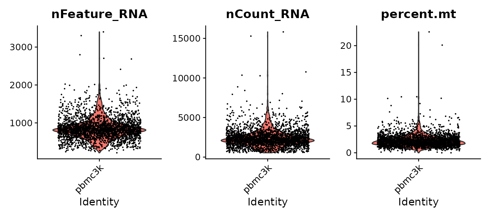
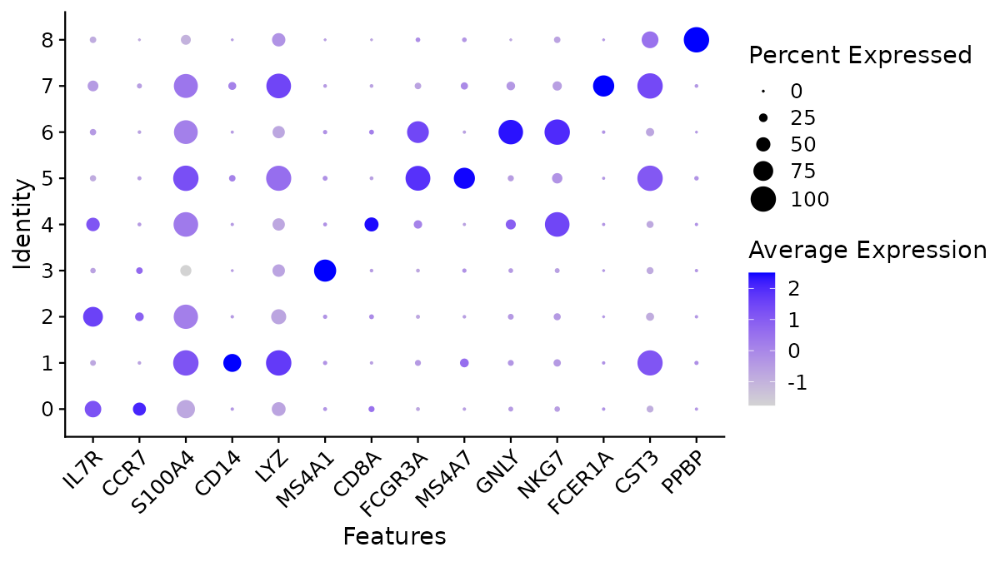
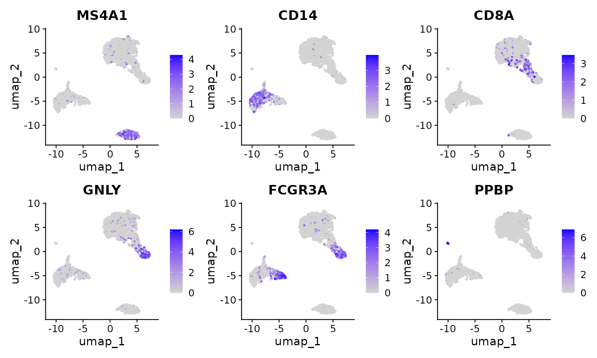
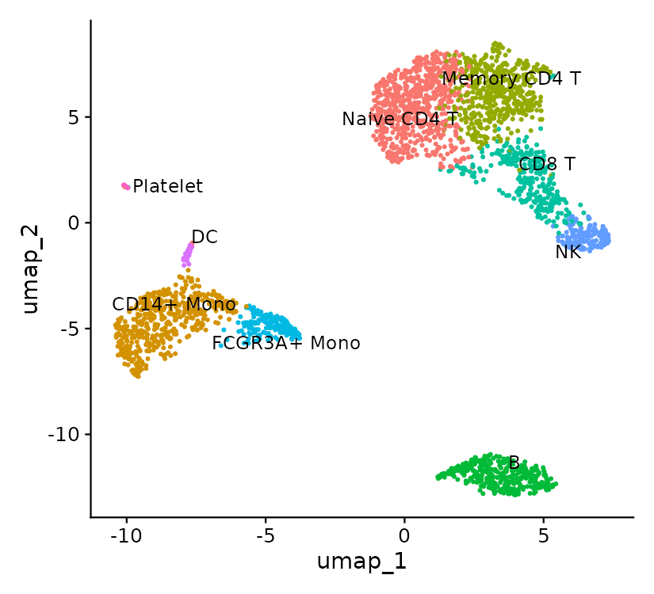

# Single-cell RNA-Seq

Bulk RNA-Seq measures the average expression of all cells in a sample.
Single-cell RNA-Seq (scRNA-Seq) measures expression in each cell.
Use it to find cell types, cell states and the composition of a tissue.

Read the [bulk RNA-Seq lecture](RNASeq) first. Many ideas carry over: count data, normalization, design, and false discovery rate.

## Learning goals

After this lecture you can:

1. Explain how cell barcodes and UMIs turn reads into a cell x gene count matrix.
2. Run a standard Seurat analysis: QC, normalization, variable genes, PCA, clustering, UMAP, marker genes.
3. Choose QC thresholds and a number of PCs from plots, not from defaults.
4. Name clusters from marker gene evidence.
5. Explain why cells are not biological replicates, and why condition comparisons need pseudobulk.

# How single-cell libraries work

## Platforms

* **Droplet** (10x Genomics Chromium and others): thousands to millions of cells. Only the 3' or 5' end of each transcript is read. This is the most common platform.
* **Plate-based** (Smart-seq2/3): hundreds of cells. Full-length transcripts, so you can study isoforms and SNPs.
* **Single-nucleus RNA-Seq** (snRNA-Seq): uses nuclei, not cells. Use it for frozen tissue or for cells that do not dissociate (neurons, muscle, plant cells with walls, many fungi). Nuclei have more intronic (pre-mRNA) reads, so count introns too.

## Barcodes and UMIs

In a 10x library, read 1 holds two short tags. Read 2 holds the cDNA sequence.

* **Cell barcode** (16 bp): the same for all reads from one droplet, which usually holds one cell.
* **UMI**, unique molecular identifier (10-12 bp): a random tag on each captured mRNA molecule. PCR copies of one molecule share a UMI. Count UMIs, not reads, to remove PCR duplicates.

The output of the first step is a sparse matrix: genes x cells, with UMI counts. Most entries are zero. For PBMC 3k, the matrix has 2,700 cells and 32,738 genes, and about 97% of the values are zero.

## Problems specific to droplets

* **Empty droplets**: droplets with only ambient RNA. Cell Ranger removes most of them ("filtered" matrix).
* **Ambient RNA**: free RNA from lysed cells gets into every droplet. Tools: [SoupX](https://cran.r-project.org/package=SoupX), [CellBender](https://github.com/broadinstitute/CellBender).
* **Doublets**: two cells in one droplet. They look like a new "intermediate" cell type. Tool: [scDblFinder](https://bioconductor.org/packages/release/bioc/html/scDblFinder.html).
* **Dying cells**: high percent of mitochondrial reads.

# From reads to a count matrix

These tools do barcode correction, alignment, UMI collapsing and cell calling.

* [Cell Ranger](https://www.10xgenomics.com/support/software/cell-ranger/latest) (10x Genomics). On the cluster: `module load cellranger/10.0.0`
* [STARsolo](https://github.com/alexdobin/STAR/blob/master/docs/STARsolo.md): STAR with single-cell options. Fast and free.
* [simpleaf / alevin-fry](https://simpleaf.readthedocs.io/) (salmon family) and kallisto | bustools: fast pseudo-alignment tools.

An example Cell Ranger job. You must download a reference (for example `refdata-gex-GRCh38-2024-A` from 10x) first. We did not run this command in class.

```bash
#!/bin/bash -l
#SBATCH -p epyc -N 1 -n 1 -c 16 --mem 64G --time 12:00:00
#SBATCH -J cellranger
#SBATCH -o logs/%x.%j.log
module load cellranger/10.0.0
set -euo pipefail
CPU=${SLURM_CPUS_PER_TASK:-1}
# FASTQ names must follow the 10x form: SAMPLE_S1_L001_R1_001.fastq.gz
cellranger count --id=pbmc_sample1 \
  --transcriptome=refdata-gex-GRCh38-2024-A \
  --fastqs=fastq --sample=pbmc_sample1 \
  --create-bam=false \
  --localcores=$CPU --localmem=60
```

Look at `pbmc_sample1/outs/web_summary.html` first. Check the estimated number of cells, the median genes per cell, and the fraction of reads in cells. The count matrix is in `outs/filtered_feature_bc_matrix/`.

# Worked example: PBMC 3k with Seurat

Data: 2,700 peripheral blood mononuclear cells (PBMC) from one healthy donor. 10x Genomics Chromium, Cell Ranger output on the hg19 reference. This is the data of the [Seurat PBMC 3k tutorial](https://satijalab.org/seurat/articles/pbmc3k_tutorial). Read that tutorial for more detail on each step.

```bash
mkdir -p ~/bigdata/RNASeq/scRNA && cd ~/bigdata/RNASeq
curl -L -o scRNA/pbmc3k.tar.gz \
  https://cf.10xgenomics.com/samples/cell/pbmc3k/pbmc3k_filtered_gene_bc_matrices.tar.gz
tar -C scRNA -xzf scRNA/pbmc3k.tar.gz
ls scRNA/filtered_gene_bc_matrices/hg19   # barcodes.tsv  genes.tsv  matrix.mtx
```

The full script is `/bigdata/gen220/shared/data-examples/rnaseq/scripts/sc_pbmc3k.R`. Run it with `sbatch` (4 CPUs, 16 GB, R/4.5.2). It ran in under 1 minute and used about 1 GB of memory. The steps are below.

## 1. Read the matrix and do per-cell QC

```r
library(Seurat); library(ggplot2)
counts <- Read10X("scRNA/filtered_gene_bc_matrices/hg19")
pbmc <- CreateSeuratObject(counts, project = "pbmc3k", min.cells = 3, min.features = 200)
pbmc[["percent.mt"]] <- PercentageFeatureSet(pbmc, pattern = "^MT-")
VlnPlot(pbmc, c("nFeature_RNA", "nCount_RNA", "percent.mt"), ncol = 3)
pbmc <- subset(pbmc, subset = nFeature_RNA > 200 & nFeature_RNA < 2500 & percent.mt < 5)
```



* `nFeature_RNA`: genes detected per cell. Very low means an empty droplet or a broken cell. Very high can mean a doublet.
* `nCount_RNA`: UMIs per cell.
* `percent.mt`: percent of UMIs from mitochondrial genes. High values mean dying cells.

The cut-offs depend on the tissue and the protocol. Look at the plot, then choose. Here 2,638 of 2,700 cells pass.

## 2. Normalize, select variable genes, scale, PCA

```r
pbmc <- NormalizeData(pbmc)                          # counts / cell total x 10,000, then log1p
pbmc <- FindVariableFeatures(pbmc, nfeatures = 2000) # genes that vary most between cells
pbmc <- ScaleData(pbmc)                              # each gene: mean 0, variance 1
pbmc <- RunPCA(pbmc)
ElbowPlot(pbmc, ndims = 30)
```


The elbow plot shows the standard deviation of each PC. After about PC 9 the curve is flat, so we use PCs 1-10. This is the same choice as the Seurat tutorial. `SCTransform()` is an alternative normalization method that combines these three steps.

## 3. Cluster the cells, then make a UMAP

```r
pbmc <- FindNeighbors(pbmc, dims = 1:10)        # k-nearest-neighbour graph in PC space
pbmc <- FindClusters(pbmc, resolution = 0.5)    # Louvain community detection on the graph
pbmc <- RunUMAP(pbmc, dims = 1:10)
DimPlot(pbmc, label = TRUE)
```

* Clustering is done on the graph in PC space, **not** on the UMAP.
* `resolution` controls the number of clusters. Higher values give more, smaller clusters. No value is "correct". Choose one that gives clusters you can support with marker genes.
* UMAP is for display only. Distances between clusters and cluster sizes on a UMAP are not reliable. Do not do statistics on UMAP coordinates.

## 4. Find marker genes

```r
markers <- FindAllMarkers(pbmc, only.pos = TRUE, min.pct = 0.25, logfc.threshold = 0.25)
DotPlot(pbmc, features = c("IL7R","CCR7","S100A4","CD14","LYZ","MS4A1","CD8A",
                           "FCGR3A","MS4A7","GNLY","NKG7","FCER1A","CST3","PPBP")) + RotatedAxis()
FeaturePlot(pbmc, c("MS4A1", "CD14", "CD8A", "GNLY", "FCGR3A", "PPBP"))
```



In a dot plot, the dot size is the percent of cells in the cluster that express the gene. The colour is the average scaled expression.



## 5. Name the clusters

We gave names from the marker evidence. The top markers came from `FindAllMarkers`. The known markers came from the dot plot.

| Cluster | Cells | Evidence | Cell type |
|---|---|---|---|
| 0 | 684 | IL7R, CCR7 | Naive CD4 T |
| 1 | 481 | CD14, LYZ, FCN1 | CD14+ monocyte |
| 2 | 476 | IL7R, S100A4 | Memory CD4 T |
| 3 | 344 | MS4A1, CD79A | B cell |
| 4 | 291 | CD8A, CCL5, GZMK | CD8 T |
| 5 | 162 | FCGR3A, MS4A7 | FCGR3A+ monocyte |
| 6 | 155 | GNLY, NKG7, GZMB | NK cell |
| 7 | 32 | FCER1A, CST3 | Dendritic cell |
| 8 | 13 | PPBP, GP9 | Platelet |

```r
labels <- c("0" = "Naive CD4 T", "1" = "CD14+ Mono", "2" = "Memory CD4 T", "3" = "B",
            "4" = "CD8 T", "5" = "FCGR3A+ Mono", "6" = "NK", "7" = "DC", "8" = "Platelet")
pbmc <- RenameIdents(pbmc, labels)
DimPlot(pbmc, label = TRUE, repel = TRUE) + NoLegend()
```



Note: the top markers of cluster 0 are ribosomal protein genes (RPS12, RPS6). These genes are not specific to a cell type. Use known markers (IL7R, CCR7) for the name. Reference-based tools (Azimuth, SingleR) can also assign names. Always check their output against marker genes.

# Critical concepts

1. **Cells are not replicates.** Cells from one donor are not independent samples. A test that treats each cell as a replicate gives many false positives. To compare conditions (treated vs control, disease vs healthy), you need several donors or animals per condition.
2. **Pseudobulk for condition comparisons.** Sum the counts of each cell type in each sample. Then use DESeq2 or edgeR as for bulk RNA-Seq, with the sample as the replicate (Squair et al. 2021). Seurat has `AggregateExpression()` for this. See the [Seurat DE vignette](https://satijalab.org/seurat/articles/de_vignette).
3. **Marker tests are not condition tests.** `FindAllMarkers` compares clusters that were made from the same data. Its p-values are good for ranking genes, but they are too small to be true p-values.
4. **Batch effects and integration.** Samples processed on different days often separate on the UMAP. Integration tools (Harmony, Seurat integration) align them. See the [Seurat integration vignette](https://satijalab.org/seurat/articles/integration_introduction). Integrate for clustering and display. Use the raw counts for DE.
5. **Design still matters.** Do not run all controls on one day and all treated samples on another day. Multiplexing (hashtags or genetic demultiplexing, Kang et al. 2017) puts several samples in one run.
6. **Record your choices.** Write down the QC cut-offs, the number of PCs, the resolution and the package versions (`sessionInfo()`). Other choices give other clusters.

# Python alternative

[Scanpy](https://scanpy.readthedocs.io/en/stable/tutorials/basics/clustering.html) (Wolf et al. 2018) does the same analysis in Python with AnnData objects. It is not in the default `python3` on the cluster. Install it in your own environment, for example with pixi or conda.

# Exercise

1. Run `sc_pbmc3k.R`. Change `resolution` to 0.2 and to 1.0. How many clusters do you get? Which cell types split or merge?
2. Change the number of PCs from 10 to 5 and to 30. Do the cell types change?
3. Which marker in the dot plot separates naive CD4 T from memory CD4 T cells?
4. A multi-donor dataset for pseudobulk practice: Kang et al. 2017 PBMC with and without interferon-beta. It is available as `ifnb` in the SeuratData package. We did not test this dataset in class.

# Lectures and tutorials

* [Seurat PBMC 3k tutorial](https://satijalab.org/seurat/articles/pbmc3k_tutorial)
* [Orchestrating Single-Cell Analysis with Bioconductor (OSCA)](https://bioconductor.org/books/release/OSCA/) - free book
* [Single-cell best practices](https://www.sc-best-practices.org/) - free book, Python
* [Carpentries: single-cell RNA-Seq with Bioconductor](https://carpentries-incubator.github.io/bioc-scrnaseq/)
* [HBC training: single-cell RNA-Seq](https://github.com/hbctraining/scRNA-seq_online)
* [Galaxy Training: transcriptomics](https://training.galaxyproject.org/training-material/topics/transcriptomics/) - includes single-cell
* [nf-core/scrnaseq](https://nf-co.re/scrnaseq) pipeline

# Papers

* Zheng et al. 2017. Massively parallel digital transcriptional profiling of single cells. Nat Commun. doi:[10.1038/ncomms14049](https://doi.org/10.1038/ncomms14049) (the 10x platform and PBMC data)
* Luecken and Theis. 2019. Current best practices in single-cell RNA-seq analysis: a tutorial. Mol Syst Biol. doi:[10.15252/msb.20188746](https://doi.org/10.15252/msb.20188746)
* Heumos et al. 2023. Best practices for single-cell analysis across modalities. Nat Rev Genet. doi:[10.1038/s41576-023-00586-w](https://doi.org/10.1038/s41576-023-00586-w)
* Squair et al. 2021. Confronting false discoveries in single-cell differential expression. Nat Commun. doi:[10.1038/s41467-021-25960-2](https://doi.org/10.1038/s41467-021-25960-2)
* Hao et al. 2023. Dictionary learning for integrative, multimodal and scalable single-cell analysis (Seurat v5). Nat Biotechnol. doi:[10.1038/s41587-023-01767-y](https://doi.org/10.1038/s41587-023-01767-y)
* Korsunsky et al. 2019. Fast, sensitive and accurate integration of single-cell data with Harmony. Nat Methods. doi:[10.1038/s41592-019-0619-0](https://doi.org/10.1038/s41592-019-0619-0)
* Kang et al. 2017. Multiplexed droplet single-cell RNA-sequencing using natural genetic variation. Nat Biotechnol. doi:[10.1038/nbt.4042](https://doi.org/10.1038/nbt.4042)
* Wolf et al. 2018. SCANPY: large-scale single-cell gene expression data analysis. Genome Biol. doi:[10.1186/s13059-017-1382-0](https://doi.org/10.1186/s13059-017-1382-0)
